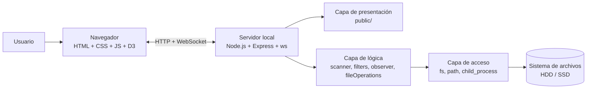
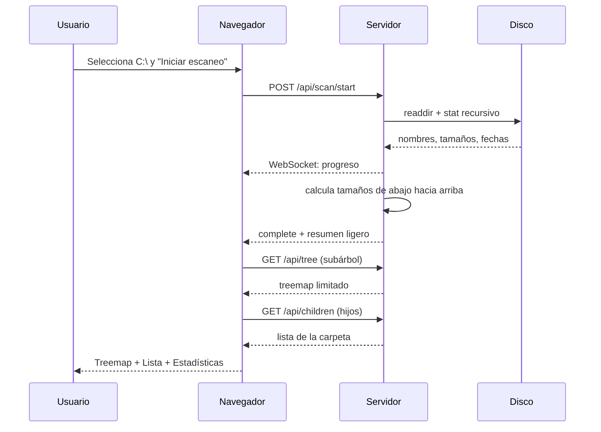
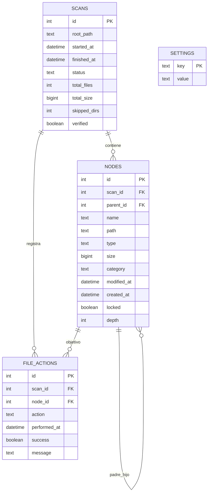

# DiskMap — Guion de presentación

**Asignatura:** Ingeniería de Software — Evaluación 2
**Producto:** DiskMap — Analizador y visualizador de almacenamiento local
**Integrantes:** Iñaki Miranda · Salvador Castillo · Mauricio Garrido
**Duración objetivo:** 15–20 minutos + preguntas

## Archivos de la presentación

| Archivo | Uso |
|---|---|
| `docs/presentacion.html` | Deck proyectable. Se abre en el navegador; se navega con `←` `→` (también `Espacio`, `Inicio`, `Fin`). Funciona sin Internet. |
| `docs/presentacion.pdf` | Respaldo para proyectar o imprimir. 17 páginas, una diapositiva por página. |
| `docs/PRESENTACION.md` | Este guion: qué decir en cada diapositiva, demo paso a paso, FAQ y checklist. |

Para regenerar el PDF después de editar el HTML, abre `presentacion.html` en Edge o Chrome y usa **Imprimir → Guardar como PDF** (tamaño horizontal, sin encabezados). El CSS de impresión ya deja una diapositiva por página.

---

## 0. Mensaje clave de la presentación

> **DiskMap convierte un disco lleno en un mapa visual accionable, sin instalar nada y sin enviar datos a la nube.**

Todo lo que se muestre debe reforzar tres ideas:

1. **Problema real:** no sabemos qué ocupa el disco.
2. **Solución visual:** treemap + lista + búsqueda + acciones seguras.
3. **Ingeniería detrás:** arquitectura por capas, patrones Observer/Strategy, ISO/IEC 25010 y 12207, y una decisión consciente sobre bases de datos.

---

## 1. Estructura y tiempos

| # | Diapositiva | Tema | Tiempo |
|---|---|---|---|
| 1 | Portada | Nombre, integrantes, mensaje | 0:30 |
| 2 | Problema | Falta de visibilidad del almacenamiento | 1:30 |
| 3 | Solución | DiskMap y propuesta de valor | 1:30 |
| 4 | Historias de usuario | HU1–HU5 y trazabilidad | 1:30 |
| 5 | Demo | Demostración en vivo | 5:00 |
| 6 | Arquitectura | Cliente-servidor + capas | 1:30 |
| 7 | Patrones | Observer y Strategy | 1:30 |
| 8 | Cómo funciona | Escaneo, árbol, carga bajo demanda | 1:30 |
| 9 | ISO/IEC 25010 | Calidad del producto | 2:00 |
| 10 | ISO/IEC/IEEE 12207 | Ciclo de vida y Scrum | 1:30 |
| 11 | Base de datos | Decisión actual y modelo futuro | 2:00 |
| 12 | Seguridad y ética | Permisos, papelera, datos locales | 1:00 |
| 13 | Pruebas y métricas | Evidencia con discos reales | 1:30 |
| 14 | Brand Book | Identidad del producto | 0:45 |
| 15 | Cierre | Limitaciones, futuro y preguntas | 1:00 |

> Si el tiempo aprieta, recorta la diapositiva 14 (Brand Book) y reduce la demo a 3 minutos.

---

## 2. Diapositivas: contenido y guion

### Diapositiva 1 — Portada

**Visual**

- Logo 💾 + **DiskMap**
- Subtítulo: *Analizador y visualizador de almacenamiento local*
- Integrantes y asignatura
- Eslogan: **“Ve tu disco. Libera tu espacio.”**

**Guion**

> “Buenos días. Somos [nombres] y les presentamos DiskMap, una aplicación web local que permite entender en segundos qué está ocupando el espacio de un disco y actuar sobre los archivos más pesados sin instalar software adicional.”

---

### Diapositiva 2 — El problema

**Visual**

- El disco se llena y no sabemos por qué.
- El explorador de Windows obliga a revisar carpeta por carpeta.
- WinDirStat: interfaz antigua y lento en SSD grandes.
- ncdu: solo terminal, excluye usuarios no técnicos.
- Consecuencia: pérdida de tiempo, decisiones inseguras, archivos que nunca se liberan.

**Guion**

> “El problema no es solo quedarse sin espacio: es no saber qué lo está consumiendo. Las herramientas tradicionales son lentas, antiguas o difíciles de usar. Eso lleva a borrar a ciegas o a no borrar nada.”

---

### Diapositiva 3 — La solución: DiskMap

**Visual**

| Antes | Con DiskMap |
|---|---|
| Revisar carpeta por carpeta | Mapa visual del disco completo |
| Instalar software pesado | Se abre en el navegador |
| Terminal o interfaz antigua | UI moderna, clara y en español |
| Riesgo al borrar | Confirmación + papelera + información |
| Datos enviados a la nube | Todo se queda en tu computador |

**Propuesta de valor**

- Treemap interactivo con colores por tipo de archivo.
- Lista con barras de peso relativo.
- Búsqueda global en todo el disco.
- Filtros por categoría, tamaño y antigüedad.
- Gestión segura: papelera, eliminar, abrir ubicación.

**Guion**

> “DiskMap resuelve el problema en tres pasos: escaneas, ves el mapa y actúas. La misma información se puede explorar como treemap o como lista, y todas las acciones destructivas piden confirmación.”

---

### Diapositiva 4 — Historias de usuario

**Visual**

| HU | Historia | Implementación |
|---|---|---|
| HU1 | Escanear unidad o carpeta | Lista de unidades, explorador, barra de progreso, cancelar |
| HU2 | Visualización gráfica | Treemap D3 con tamaños proporcionales, colores y tooltips |
| HU3 | Gestión de archivos | Menú contextual: papelera, eliminar, abrir ubicación, info |
| HU4 | Acceso por navegador | Servidor local en `127.0.0.1`, puerto automático, sin Internet |
| HU5 | Filtrado dinámico | Categoría, tamaño y antigüedad; actualiza treemap y lista |

**Guion**

> “Las cinco historias de usuario del documento están implementadas. La trazabilidad es directa: cada HU tiene una pantalla y un componente concreto. Por ejemplo, HU2 vive en `treemap.js` y HU5 en `filters.js`.”

---

### Diapositiva 5 — Demo en vivo

**Visual**

- Checklist de demo (ver sección 3).
- Captura o video de respaldo por si falla la red o el disco.

**Guion**

> “Ahora les muestro el producto funcionando.”

**Consejo:** ten el servidor ya iniciado y, si es posible, un escaneo de `C:\Program Files` previamente cargado. Así la demo no depende de esperar 90 segundos.

---

### Diapositiva 6 — Arquitectura

**Visual**



**Guion**

> “Usamos una arquitectura cliente-servidor con organización por capas. El navegador es el cliente; el servidor corre en la misma máquina y habla directamente con el sistema de archivos. Esto cumple HU4: no hay nube, no hay datos saliendo del equipo.”

**Puntos a mencionar**

- **Cliente-servidor:** navegador ↔ servidor local por `localhost`.
- **Tres capas:** presentación, lógica de aplicación y acceso al sistema de archivos.
- **Ventaja:** cambiar la interfaz no obliga a tocar el escaneo, y viceversa.

---

### Diapositiva 7 — Patrones de diseño

**Visual**

| Patrón | Dónde está | Para qué |
|---|---|---|
| **Observer** | `src/observer.js`, WebSocket | Notificar progreso y fin del escaneo a la UI sin acoplar |
| **Strategy** | `src/filters.js` | Encapsular filtros por categoría, tamaño, extensión y antigüedad |

**Observer en una frase**

> El estado del escaneo es el sujeto observable; la barra de progreso, el contador y el resumen son observadores.

**Strategy en una frase**

> El `FilterManager` es el contexto; cada filtro (`CategoryFilter`, `SizeFilter`, `AgeFilter`, `ExtensionFilter`) implementa el mismo contrato `matches(file)`.

**Guion**

> “Observer nos permite agregar un nuevo panel sin tocar el escáner. Strategy nos permite agregar un filtro nuevo sin tocar el gestor. Ambos reducen el acoplamiento y facilitan el mantenimiento, que es justamente lo que pide ISO 25010.”

---

### Diapositiva 8 — Cómo funciona el escaneo

**Visual**



**Puntos clave**

- Recorrido recursivo con `fs.promises.readdir(..., { withFileTypes: true })`.
- Tamaños de carpetas calculados **bottom-up** (`_calcSizes`).
- Carpetas sin permisos: se muestran con 🔒, no se fuerza elevación.
- Carpetas y archivos de **0 bytes** se conservan.
- Symlinks ignorados para evitar bucles y resultados inconsistentes.
- `_stats.verified` comprueba que el conteo del árbol coincide con el contador.

**Guion**

> “El escaneo no bloquea la interfaz: corre en segundo plano y el progreso viaja por WebSocket. Al terminar, el servidor no envía todo el árbol: guarda el árbol completo y entrega solo las porciones que la pantalla necesita.”

---

### Diapositiva 9 — El problema de los 164 MB (carga bajo demanda)

**Visual**

| Métrica | Antes | Después |
|---|---|---|
| Respuesta de `/api/scan/status` en `C:\` | **163,9 MB** | **620 bytes** |
| Tiempo de serialización | ~93 s | Instantáneo |
| Árbol enviado al navegador | Completo (450.022 archivos) | Solo resúmenes y porciones |
| Experiencia | Navegador congelado | Treemap y lista fluidos |

**Endpoints de carga bajo demanda**

| Endpoint | Función |
|---|---|
| `GET /api/tree?path=...&depth=2&maxNodes=5000` | Subárbol limitado para el treemap |
| `GET /api/children?path=...` | Hijos directos para la lista |
| `GET /api/search?q=...` | Búsqueda global paginada |
| `GET /api/scan/status` | Estado ligero, sin árbol |

**Guion**

> “Este fue el hallazgo más importante de las pruebas. Enviar 450.000 archivos por WebSocket congelaba el navegador. La solución fue mantener el árbol en el servidor y pedir solo lo necesario. El estado pasó de 164 MB a 620 bytes, y el treemap de la raíz pesa solo 34 KB.”

---

### Diapositiva 10 — ISO/IEC 25010: calidad del producto

**Visual**

| Característica | Evidencia en DiskMap |
|---|---|
| **Adecuación funcional** | HU1–HU5 implementadas: escaneo, treemap, lista, filtros y gestión de archivos |
| **Eficiencia de desempeño** | Escaneo asíncrono, carga bajo demanda, top-N en treemap, paginación |
| **Compatibilidad** | Funciona en Chrome, Edge y Firefox; D3 local; sin Internet |
| **Usabilidad** | UI en español, colores por categoría, tooltips, breadcrumbs, búsqueda, tema claro/oscuro |
| **Fiabilidad** | `verified`, reintento de `stat`, omisión de symlinks, cancelación, fallback de polling |
| **Seguridad** | Privilegios mínimos, carpetas bloqueadas visibles, confirmación antes de borrar, papelera primero |
| **Mantenibilidad** | Arquitectura por capas, módulos pequeños, patrones Observer/Strategy, README |
| **Portabilidad** | Node.js multiplataforma; solo requiere navegador y Node 18+ |

**Guion**

> “ISO/IEC 25010 nos sirve como checklist de calidad. No decimos ‘es de calidad’ de forma abstracta: cada característica tiene una evidencia concreta en el código y en las pruebas. Por ejemplo, eficiencia se demuestra con la reducción de 164 MB a 620 bytes; fiabilidad, con el indicador `verified` y el fallback de polling.”

**Nota opcional**

> La versión 2023 de ISO/IEC 25010 renombró algunas características (por ejemplo, “usabilidad” pasó a “capacidad de interacción”) y agregó otras. En la presentación usamos el modelo de 8 características de la versión 2011, que es el que aparece en el documento del ramo.

---

### Diapositiva 11 — ISO/IEC/IEEE 12207: ciclo de vida

**Visual**

| Proceso / etapa | Cómo se aplicó en DiskMap | Evidencia |
|---|---|---|
| Requerimientos | HU1–HU5 con criterios de aceptación | Documento EV2 |
| Análisis y diseño | Arquitectura 4+1, capas, patrones | `docs/`, `README.md` |
| Implementación | 4 sprints de 2 semanas | Historial de commits / tablero |
| Verificación y validación | Pruebas de escaneo, consistencia y UI | Métricas de la sección 4 |
| Operación | `npm start`, servidor local | `package.json` |
| Mantenimiento | Módulos desacoplados, filtros extensibles | `src/filters.js` |

**Guion**

> “12207 nos da el marco de procesos. Lo usamos para conectar cada historia de usuario con un componente y con una prueba. Eso es trazabilidad: no solo ‘funciona’, sino que sabemos por qué y cómo lo verificamos.”

**Tabla de trazabilidad resumida**

| HU | Componente | Prueba |
|---|---|---|
| HU1 | `scanner.js`, `/api/scan/start` | Escaneo de carpeta y disco completo |
| HU2 | `treemap.js`, `/api/tree` | Zoom, tooltips, colores |
| HU3 | `fileOperations.js`, menú contextual | Papelera y eliminación con confirmación |
| HU4 | `server.js`, `public/` | Navegador en `localhost`, sin Internet |
| HU5 | `filters.js`, `app.js` | Filtros de categoría, tamaño y antigüedad |

---

### Diapositiva 12 — Base de datos: la decisión actual

**Visual**

> **DiskMap no usa un DBMS en su versión actual. Usa estructuras en memoria porque el origen de la verdad es el sistema de archivos y el análisis es efímero.**

**¿Por qué?**

| Razón | Explicación |
|---|---|
| Datos efímeros | Cada escaneo reemplaza al anterior; no hay historial que conservar |
| Fuente de verdad | El disco es la fuente; una base de datos sería una copia que se desactualiza |
| Rendimiento | Evita I/O extra y latencia de escritura durante el escaneo |
| Portabilidad | Cero configuración: `npm start` y listo |
| Requisito HU4 | Todo local, sin servicios externos ni instalación de DBMS |

**Estructuras usadas**

```js
// Nodo del árbol en memoria
{
  name: "Windows",
  path: "C:\\Windows",
  size: 25_000_000_000,
  type: "directory",
  category: "directory",
  children: [ ... ],
  modified: 1710000000000,
  locked: false
}

// Índice para búsquedas O(1) por ruta
Map<path, node>
```

**Ventajas**

- Árbol jerárquico natural para el treemap.
- Cálculo de tamaños bottom-up en una sola pasada.
- Índice `Map` para responder `/api/tree` y `/api/children` sin recorrer todo.
- Sin esquema, sin migraciones, sin servidor de base de datos.

**Limitación**

- Si se cierra el servidor, se pierde el resultado del escaneo.
- No hay historial para comparar “antes vs. después”.
- No hay auditoría persistente de acciones.

**Guion**

> “Nos preguntaron por la base de datos. La decisión fue consciente: para un analizador en tiempo real, la base de datos natural es el propio sistema de archivos. Guardar una copia en SQL durante el escaneo agregaría latencia y riesgos de inconsistencia. Lo que sí haría sentido es una base de datos para el historial, y ese es el siguiente paso.”

---

### Diapositiva 13 — Base de datos: modelo propuesto para la siguiente versión

**Visual**



**DDL de referencia (SQLite)**

```sql
CREATE TABLE scans (
  id            INTEGER PRIMARY KEY AUTOINCREMENT,
  root_path     TEXT NOT NULL,
  started_at    TEXT NOT NULL,
  finished_at   TEXT,
  status        TEXT NOT NULL,
  total_files   INTEGER NOT NULL DEFAULT 0,
  total_size    INTEGER NOT NULL DEFAULT 0,
  skipped_dirs  INTEGER NOT NULL DEFAULT 0,
  verified      INTEGER NOT NULL DEFAULT 0
);

CREATE TABLE nodes (
  id          INTEGER PRIMARY KEY AUTOINCREMENT,
  scan_id     INTEGER NOT NULL REFERENCES scans(id) ON DELETE CASCADE,
  parent_id   INTEGER REFERENCES nodes(id) ON DELETE CASCADE,
  name        TEXT NOT NULL,
  path        TEXT NOT NULL,
  type        TEXT NOT NULL,
  size        INTEGER NOT NULL DEFAULT 0,
  category    TEXT,
  modified_at TEXT,
  created_at  TEXT,
  locked      INTEGER NOT NULL DEFAULT 0,
  depth       INTEGER NOT NULL DEFAULT 0
);

CREATE INDEX idx_nodes_scan_parent ON nodes(scan_id, parent_id);
CREATE INDEX idx_nodes_scan_size   ON nodes(scan_id, size DESC);
CREATE INDEX idx_nodes_scan_path   ON nodes(scan_id, path);

CREATE TABLE file_actions (
  id           INTEGER PRIMARY KEY AUTOINCREMENT,
  scan_id      INTEGER REFERENCES scans(id) ON DELETE SET NULL,
  node_id      INTEGER REFERENCES nodes(id) ON DELETE SET NULL,
  action       TEXT NOT NULL,
  performed_at TEXT NOT NULL,
  success      INTEGER NOT NULL DEFAULT 0,
  message      TEXT
);

CREATE TABLE settings (
  key   TEXT PRIMARY KEY,
  value TEXT
);
```

**¿SQLite o PostgreSQL?**

| Opción | Cuándo conviene |
|---|---|
| **SQLite** | Uso local, cero configuración, un solo usuario. **Recomendado para DiskMap.** |
| PostgreSQL | Varios usuarios, servidor central, historial compartido |

**Estrategia de migración**

1. Mantener el escaneo en memoria (rápido).
2. Al terminar, persistir el resumen y los nodos en SQLite en segundo plano.
3. Cargar el último escaneo al iniciar para mostrar historial.
4. Comparar dos escaneos: “qué creció”, “qué se liberó”.

**Guion**

> “Este es el modelo que usaríamos si quisiéramos historial. `scans` guarda cada análisis; `nodes` guarda el árbol con `parent_id`; `file_actions` registra papelera y eliminaciones. SQLite es la opción natural porque sigue siendo local y no requiere instalar un servidor.”

---

### Diapositiva 14 — Seguridad y ética

**Visual**

- **Privilegios mínimos:** no se fuerza elevación; las carpetas sin permiso se muestran con 🔒.
- **Confirmación:** toda acción destructiva pide confirmación explícita.
- **Papelera primero:** “Mover a papelera” es la opción principal; “Eliminar permanentemente” es secundaria y advertida.
- **Todo local:** no hay telemetría ni envío de rutas o metadatos a Internet.
- **Cumplimiento:** Ley N° 19.628 (Chile) y RGPD/GDPR por diseño.
- **Transparencia:** la UI muestra el motivo cuando una carpeta no se puede leer.

**Guion**

> “La seguridad no es solo ‘no borrar’. Es operar con los permisos que el usuario ya tiene, mostrar lo que no se puede leer y pedir confirmación antes de cualquier acción irreversible. Además, el diseño es local por defecto: nada sale del computador.”

---

### Diapositiva 15 — Pruebas y métricas

**Visual**

| Prueba | Resultado |
|---|---|
| Escaneo completo de `C:\` | 450.022 archivos, 120.508 carpetas, 158,95 GB, 195 sin acceso |
| Consistencia (3 escaneos seguidos) | Mismo conteo, `verified: true` |
| Estado del escaneo | 620 bytes (antes 163,9 MB) |
| Treemap raíz | 34 KB, 238 celdas, 20 grupos |
| Lista de hijos | 69 KB, 20 elementos |
| Búsqueda global “pakchunk” | 264 resultados en ~620 ms |
| Zoom en `Windows` | ~358 ms |
| Fallback sin WebSocket | Escaneo completado y UI actualizada por polling |
| Papelera / eliminación | Probadas con archivo y carpeta de prueba |

**Guion**

> “Estas métricas son nuestra evidencia para ISO 25010. No solo decimos que es rápido: medimos el antes y el después. El caso más claro es el estado del escaneo, que pasó de 164 MB a 620 bytes.”

---

### Diapositiva 16 — Brand Book

**Visual**

| Elemento | Definición |
|---|---|
| **Nombre** | DiskMap |
| **Eslogan** | “Ve tu disco. Libera tu espacio.” |
| **Logo** | 💾 + wordmark “DiskMap” |
| **Paleta** | Azul `#3b82f6`, verde `#22c55e`, ámbar `#f59e0b`, rojo `#ef4444`, fondo `#0f172a`, texto `#e2e8f0` |
| **Tipografía** | Segoe UI / system-ui (nativa, rápida, legible) |
| **Tono** | Claro, técnico pero accesible; español neutro |
| **Personalidad** | Preciso, visual, seguro, local-first |
| **Aplicaciones** | Interfaz, README, presentación, ícono |

**Guion**

> “La identidad refuerza el producto: colores que significan peso (verde → rojo), una interfaz oscura que hace resaltar los datos y un lenguaje claro para usuarios no técnicos.”

---

### Diapositiva 17 — Cierre

**Visual**

- **Lo logrado:** producto funcional, visual, seguro y medido.
- **Limitaciones:** sin historial persistente, sin detección de duplicados, escaneo secuencial.
- **Trabajo futuro:**
  - SQLite para historial y comparación entre escaneos.
  - Worker threads para paralelizar el escaneo.
  - Detección de archivos duplicados por hash.
  - Instalador de un clic.
  - Pruebas automatizadas.
- **Cierre:** “DiskMap no solo muestra el disco: ayuda a decidir qué hacer con él.”

**Guion**

> “Terminamos con lo que sigue. Sabemos qué falta y por qué. La base de datos, la paralelización y la detección de duplicados son las mejoras con más impacto. Gracias. ¿Preguntas?”

---

## 3. Demo en vivo: guion paso a paso

### 3.1 Preparación (antes de la presentación)

1. Ejecutar `npm install` (solo la primera vez).
2. Ejecutar `npm start`. El navegador se abre solo.
3. Dejar preparada una carpeta de prueba para acciones destructivas:
   ```
   C:\DiskMapDemo\
     archivo-grande.bin
     carpeta-vacia\
     subcarpeta\
       documento.pdf
   ```
4. Opcional: escanear `C:\Program Files` antes de la demo para tener datos cargados.
5. Tener una pestaña con el treemap y otra con la lista, o cambiar entre vistas durante la demo.
6. Tener el README abierto por si preguntan por endpoints.

### 3.2 Guion de demo (5 minutos)

| Paso | Acción | Qué decir |
|---|---|---|
| 1 | Mostrar la lista de unidades | “DiskMap detecta las unidades disponibles al iniciar.” |
| 2 | Seleccionar `C:` o una carpeta | “Podemos escanear un disco completo o una carpeta específica.” |
| 3 | Clic en “Iniciar escaneo” | “El escaneo corre en segundo plano; la barra muestra el progreso en tiempo real.” |
| 4 | Mostrar estadísticas | “Archivos, tamaño total, carpetas, archivo más grande y carpetas sin acceso.” |
| 5 | Treemap | “El área es proporcional al tamaño; el color indica el tipo de archivo.” |
| 6 | Hover sobre un bloque | “Nombre, tamaño, porcentaje del total y ruta.” |
| 7 | Clic en una carpeta | “Podemos entrar en una carpeta y el breadcrumb nos permite volver.” |
| 8 | Cambiar a Lista | “La lista muestra el peso relativo con una barra de color.” |
| 9 | Ordenar por tamaño | “Podemos ordenar para encontrar lo más pesado primero.” |
| 10 | Búsqueda global | “Buscamos en todo el disco, no solo en la carpeta actual.” |
| 11 | Filtros | “Filtramos por categoría, tamaño o antigüedad; el treemap se actualiza.” |
| 12 | Clic derecho en un archivo de prueba | “Papelera, eliminar, abrir ubicación e información.” |
| 13 | Mover a papelera el archivo de prueba | “Siempre pide confirmación; la papelera es la opción segura.” |
| 14 | Mostrar una carpeta bloqueada | “Si no hay permisos, la mostramos con 🔒; no forzamos elevación.” |
| 15 | Tema claro/oscuro | “La interfaz se adapta.” |

### 3.3 Plan B si algo falla

- **El escaneo tarda:** mostrar una carpeta mediana (`C:\Program Files`) o un escaneo ya cargado. Explicar que un disco completo tarda ~90 s y que la UI sigue respondiendo.
- **No hay Internet:** D3 está incluido localmente; la app funciona igual.
- **El navegador no abre:** entrar manualmente a `http://localhost:<puerto>` (el puerto aparece en la consola).
- **El WebSocket se cae:** el polling cada 2 s recupera el estado; mencionarlo como característica de fiabilidad.
- **Acción destructiva:** usar siempre la carpeta de prueba, nunca archivos reales del sistema.

---

## 4. Preguntas frecuentes (y respuestas sugeridas)

### “¿Por qué no usaron una base de datos?”

> “Porque el análisis es efímero y la fuente de verdad es el sistema de archivos. Una base de datos durante el escaneo agregaría latencia y riesgo de inconsistencia. Para el historial sí la usaríamos: el modelo propuesto está en la diapositiva 13, con SQLite como opción local.”

### “¿Por qué Node.js y no Electron?”

> “Electron empaqueta un navegador completo y pesa cientos de MB. DiskMap usa el navegador que el usuario ya tiene y un servidor local liviano. Eso cumple HU4: acceso por navegador, sin instalación pesada.”

### “¿Cómo aseguran que dos escaneos den lo mismo?”

> “Tres mecanismos: omisión de symlinks para evitar bucles, reintento de `stat` para archivos temporalmente bloqueados y un indicador `verified` que compara el conteo del árbol con el contador del escaneo.”

### “¿Qué pasa con las carpetas sin permisos?”

> “Se muestran con 🔒 y el motivo. No intentamos elevar privilegios: es una decisión de seguridad y de privilegio mínimo. El usuario puede ejecutar como administrador si realmente lo necesita.”

### “¿Cómo manejan discos enormes?”

> “El árbol completo queda en el servidor. El navegador pide solo un subárbol limitado para el treemap, los hijos de una carpeta para la lista y resultados paginados para la búsqueda. Así el payload se mantiene pequeño.”

### “¿Cómo se compara con WinDirStat?”

> “WinDirStat es de escritorio y su interfaz es antigua. DiskMap es web local, moderno, con búsqueda global, filtros y una lista con barras de peso. Además, no requiere instalar una aplicación de escritorio.”

### “¿Qué falta?”

> “Historial persistente con SQLite, paralelización del escaneo con worker threads, detección de duplicados por hash, instalador de un clic y pruebas automatizadas.”

### “¿Cómo aplicaron ISO/IEC 25010?”

> “Como checklist de calidad con evidencia: adecuación funcional (HU1–HU5), eficiencia (164 MB → 620 bytes), fiabilidad (`verified` + fallback), seguridad (privilegio mínimo + confirmaciones), mantenibilidad (capas + patrones) y portabilidad (Node + navegador).”

### “¿Cómo aplicaron ISO/IEC/IEEE 12207?”

> “Con trazabilidad: cada HU se conecta a un componente y a una prueba. Los procesos de requerimientos, diseño, implementación, verificación y operación están cubiertos por los artefactos del proyecto y los sprints de Scrum.”

---

## 5. Checklist final antes de presentar

- [ ] `npm install` ejecutado sin errores.
- [ ] `npm start` funciona y abre el navegador.
- [ ] Escaneo de prueba cargado (o carpeta mediana lista).
- [ ] Carpeta `C:\DiskMapDemo` creada para acciones destructivas.
- [ ] Treemap y lista probados en la máquina de presentación.
- [ ] Búsqueda global probada.
- [ ] Filtros probados.
- [ ] Tema claro/oscuro probado.
- [ ] Diapositivas en PDF de respaldo (por si falla el proyector).
- [ ] Video corto de respaldo de la demo (30–60 s).
- [ ] Cronómetro: 15–20 min.
- [ ] Ensayo al menos una vez con el grupo.

---

## 6. Resumen de una frase por diapositiva

| # | Frase para memorizar |
|---|---|
| 1 | “DiskMap convierte un disco lleno en un mapa visual accionable.” |
| 2 | “El problema no es quedarse sin espacio, es no saber qué lo ocupa.” |
| 3 | “Escanear, ver y actuar, todo desde el navegador.” |
| 4 | “Las cinco historias de usuario están implementadas y trazadas.” |
| 5 | “Esto es DiskMap funcionando.” |
| 6 | “Cliente-servidor con tres capas, todo en local.” |
| 7 | “Observer para el progreso, Strategy para los filtros.” |
| 8 | “El escaneo corre en segundo plano y el árbol se calcula bottom-up.” |
| 9 | “Pasamos de 164 MB a 620 bytes con carga bajo demanda.” |
| 10 | “ISO 25010 es nuestra checklist de calidad, con evidencia.” |
| 11 | “12207 nos da trazabilidad entre HU, componente y prueba.” |
| 12 | “No usamos DBMS porque el análisis es efímero y la fuente es el disco.” |
| 13 | “Si queremos historial, SQLite con scans, nodes y file_actions.” |
| 14 | “Privilegio mínimo, confirmación y todo local.” |
| 15 | “Medimos: 450.022 archivos, 620 bytes de estado, 264 resultados en 620 ms.” |
| 16 | “Una identidad precisa, visual y segura.” |
| 17 | “Lo que falta tiene prioridad y camino claro.” |
